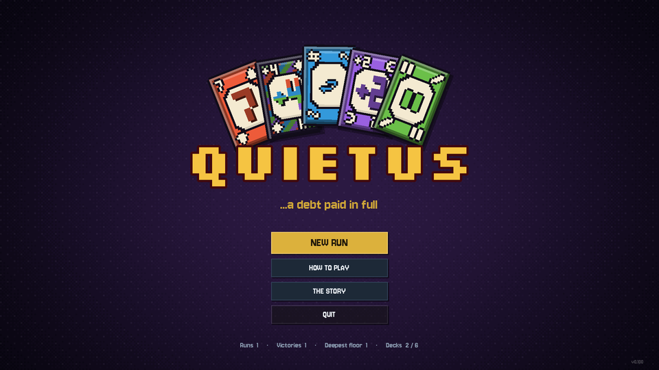
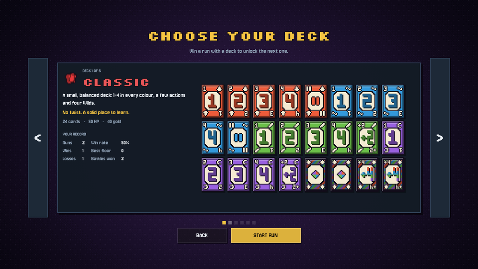
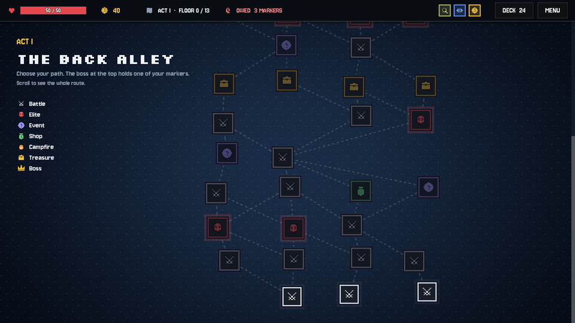
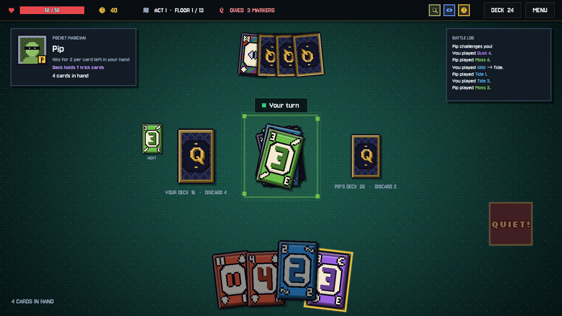

# Quietus

*...a debt paid in full.*

**Quietus** is a pixel-art deck-building roguelike built around a fast shedding card game: match the top card by colour, number or symbol, and be the first to empty your hand. Fight your way through three acts of card sharps, collect charms and trick cards, and win back the debt you owe the Dealer.

Made in **Godot 4.5**. Every card, icon, portrait and sound effect is generated in code.



| | |
| --- | --- |
|  |  |
|  | |

## The story

One bad night at the Dealer's table cost you everything you had, and then some.

The Dealer has written your debt on three markers and handed them to his three keepers: one in **the Back Alley**, one in **the Velvet Casino**, and the last in **the Hall of Quietus**. Beat each keeper and their marker is yours to tear up. Clear all three and you earn your *quietus*: an old word for a debt paid in full.

The prologue plays on your first run, and you can re-read it from **The Story** on the title screen. The top bar shows how many markers you still owe.

## Features

- **Card battles** against 29 opponents, each with their own deck and play style. Elites and bosses bend the rules with special abilities.
- **Branching maps** across three acts of 13 floors, with battles, elites, events, shops, campfires and treasure.
- **Your own deck** that grows and changes over the run. Add cards, remove weak ones, and enchant your favourites.
- **Trick cards** that go beyond the basics: Double Down, Freeze, Gift, Wild Swap, Wild Chain, Wild Mirror, dual-colour numbers and more.
- **23 charms** with passive powers, eight of which build around trick cards.
- **Six starting decks** to unlock, each with its own cards and perk.
- **12 events**, half of them built around trick cards.
- **Lifetime stats** for every deck: runs, wins, losses, best floor and battles won.

## How to play

### Battles

Each battle is a one-on-one duel. On your turn, play a card that matches the top of the pile by **colour**, **number** or **symbol**. Wild cards can go on anything. If you can't (or don't want to) play, draw a card; if it fits you may play it, otherwise pass. Empty your hand first to win.

You draw from **your own deck**, and the opponent draws from theirs.

### QUIET!

When a play will leave you on your last card, press **QUIET!** first. Forget, and the opponent may catch you and make you draw 2. If the opponent forgets to call it, press **CATCH!** in time to make them draw 2 instead.

### Losing a battle

If the opponent empties their hand first, you take damage for every card left in your hand, then face the same opponent again. You can't move on until you win. At 0 HP the run is over.

### Special rules

- **Bust:** anyone holding 25 cards loses the battle on the spot.
- **Time limit:** after 200 turns the smaller hand wins. A warning appears 20 turns before the limit.

### Controls

| Action | Mouse | Keyboard |
| --- | --- | --- |
| Play a card | Click it | |
| Draw a card | Click your deck | `Space` |
| Call QUIET! | QUIET! button | `Q` |
| Pass after drawing | PASS button | `Enter` |
| Catch the opponent | CATCH! button | `C` |
| Pause | MENU button | `Esc` |

Hover over any card or charm to see what it does.

## Starting decks

Win a run with a deck to unlock the next one.

| Deck | Cards | Perk |
| --- | --- | --- |
| **Classic** | 1–4 in every colour, a few actions and four Wilds | None. A solid place to learn. |
| **Standard** | 1–9 in all four colours, a Skip and Draw Two in each, and five Wilds | +10 max HP |
| **Monochrome** | A single colour (random each run): 1–9, a Skip, a Reverse and one Wild | Every card chains while the colour is yours |
| **Two-Tone** | Mostly dual-colour numbers | Starts with the Prism charm |
| **Trickster** | Low numbers padded out with every trick card | Starts with Joker's Grin |
| **High Roller** | Two colours of 1–9, a Double Down and two Wild Draw Fours | −15 max HP, +80 gold and the Lucky Coin |

## Cards

### The suits

The four colours are elemental suits, each with its own emblem:

| Suit | Colour | Emblem |
| --- | --- | --- |
| **Ember** | Orange-red | Flame |
| **Tide** | Azure | Wave |
| **Moss** | Green | Leaf |
| **Dusk** | Violet | Moon |

### Trick cards

| Card | Effect |
| --- | --- |
| Discard All | Also discards every other card of its colour from your hand. |
| Wild Swap | Choose a colour, then trade hands with the opponent. |
| Dual-colour numbers | Count as both colours. You pick which one continues. |
| Double Down (x2) | The opponent draws as many cards as they hold (max 6). |
| Freeze | You take two extra turns. |
| Gift | Give 2 random cards from your hand to the opponent (you always keep at least 1). |
| Wild Chain | Choose a colour, then play again. |
| Wild Mirror | Copies the effect of the card it covers. |

Opponents use trick cards too. From Act I, elites and bosses carry some, and from Act II regular opponents do as well. The number grows each act.

### Enchantments

Cards can be enchanted at campfires, through events, and sometimes come enchanted as rewards:

- **Gilded:** +3 gold when played.
- **Barbed:** the opponent draws 1.
- **Healing:** +2 HP.

## Charms

Charms are passive powers you collect from elites, bosses, shops and treasure. A few examples:

| Charm | Effect |
| --- | --- |
| Megaphone | QUIET! is called automatically for you. |
| Harlequin Mask | Your dual-colour cards can be played on anything. |
| High Roller | Your Double Down has no cap. Push them past 25 cards to Bust them. |
| Permafrost | Freeze gives 3 extra turns instead of 2. |
| Wrapping Paper | Gift gives away 1 more card and earns 3 gold per card gifted. |
| Clockwork | Heal 1 HP at the start of every extra turn. |
| Funhouse Mirror | Your Wild Mirror also makes the opponent draw 2. |
| Joker's Grin | Start every battle with a free random trick card. |
| Trickster's Pact | Trick cards appear far more often in rewards, shops and events. |

## The map

Each act is a branching, scrolling map of 13 floors with the boss at the top. Most floors are battles, events and elites (tougher opponents that drop a charm). Special nodes are rare and spaced out: on any route you'll find at most 2 shops, at most 2 rest sites (one is always the campfire before the boss) and exactly 1 treasure, never two in a row.

## Running the game

1. Install [Godot 4.5](https://godotengine.org/download) or newer (the standard version, not .NET).
2. Open Godot, choose **Import**, and select this folder's `project.godot`.
3. Press **F5** to play.

The project uses the **Compatibility** renderer, so it runs on almost any graphics card.

### Exporting

Use **Project → Export** in Godot. You'll need the export templates (**Editor → Manage Export Templates**) for your target platform.

- **Windows, macOS, Linux:** add a preset for the platform and export.
- **Android:** you also need JDK 17, the Android SDK and a debug keystore, set in **Editor Settings → Export → Android**. See Godot's [Exporting for Android](https://docs.godotengine.org/en/stable/tutorials/export/exporting_for_android.html) guide. Taps work as clicks, but card and charm descriptions currently rely on mouse hover, so the game isn't fully touch-friendly yet.

### Save data

Lifetime stats, unlocked decks and settings (sound, fast mode) are saved to `user://quietus_meta.cfg`. On Windows that's `%APPDATA%\Godot\app_userdata\Quietus - A Card Roguelike\`.

## Testing

`BattleState` is a pure rules engine with no UI code, so battles can be simulated headless:

```
godot --headless -s res://tests/sim_battles.gd
```

The test plays hundreds of AI-vs-AI battles and checks that:

- no cards are ever lost or duplicated;
- every battle ends;
- every opponent and every starting deck can be played;
- win rates per deck stay in a sensible range;
- generated maps follow the route rules.

## Project layout

```
scenes/Main.tscn       root scene
scripts/autoload/      RunState (run and lifetime state), Sfx (synthesised sounds)
scripts/core/          rules and data: CardData, CardFactory, BattleState, EnemyAI, Enemies,
                       Charms, MapGen, StarterDecks, Story
scripts/ui/            UIKit (theme and palette), PixelCanvas, PixelCard, CardView, Glyph,
                       CharmIcon, Avatar, Hud, DeckViewer
scripts/screens/       Main (router and HUD) and every screen: Title, DeckSelect, Map, Battle,
                       Reward, Shop, Rest, Event, End
shaders/felt.gdshader  pixelated card-table background
assets/fonts/          pixel fonts and their licences
tests/sim_battles.gd   headless rules test
docs/screenshots/      images used in this README
```

### How the art is made

There are no image files for the game itself. Everything is drawn in code:

- **`PixelCanvas`** is a tiny software rasteriser with a 3×5 bitmap font and automatic sprite outlines.
- **`PixelCard`** draws each card as a 26×38 pixel sprite, shown at 5× with nearest-neighbour filtering. Each card gets a bevelled frame, an octagonal crest plate, chunky numerals and pixel icons. The card back is a gold lattice with the Quietus **Q** sigil.
- **`Glyph`** draws the icons, and **`Avatar`** draws the opponent portraits.
- **`Sfx`** synthesises every sound effect at runtime.

## Credits

- **Fonts:** [Silkscreen](https://github.com/googlefonts/silkscreen) (The Silkscreen Project Authors) and [Jersey 10](https://github.com/scfried/soft-type-jersey) (The Soft Type Project Authors), both under the SIL Open Font License 1.1. The licence texts are in `assets/fonts/`.
- **Engine:** [Godot Engine](https://godotengine.org), MIT licence.

## Disclaimer

Quietus is an original game. It is not affiliated with, endorsed by or sponsored by any card game publisher.
